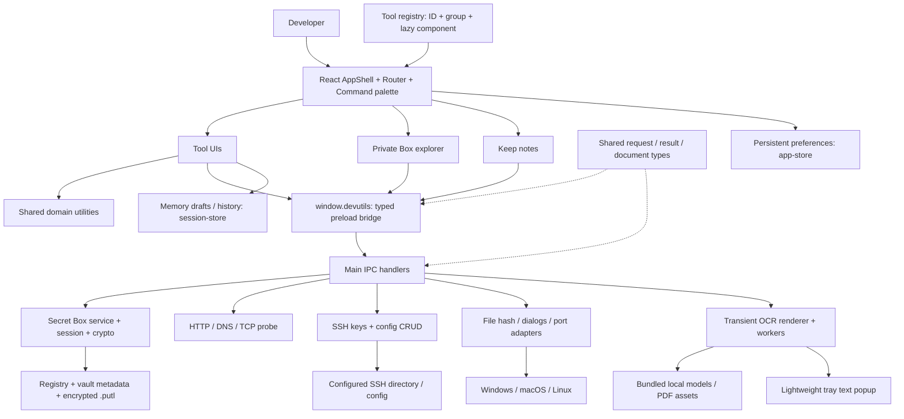
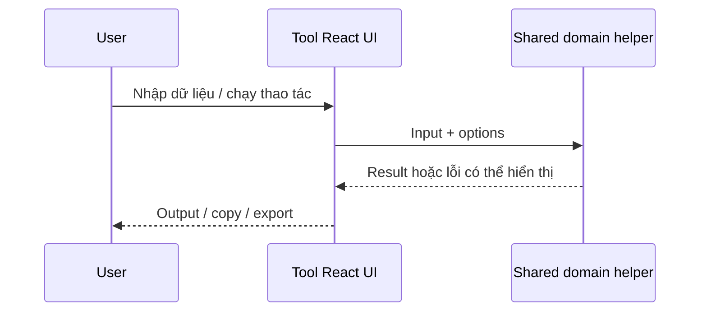
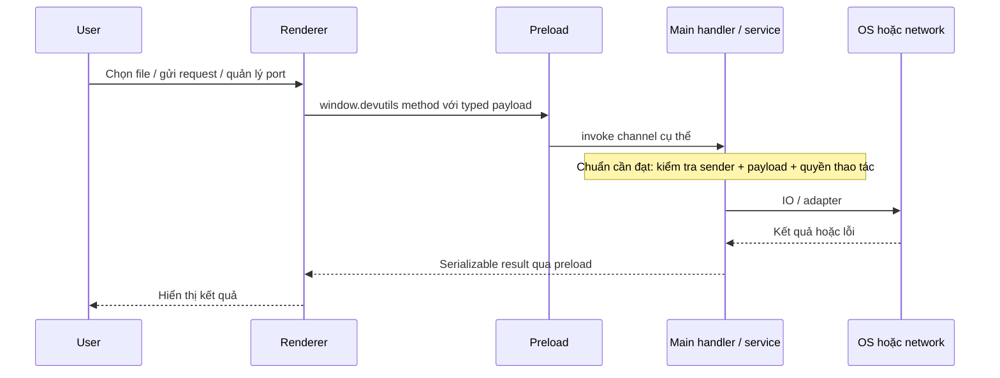
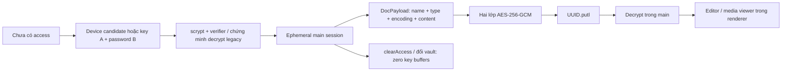

# DevFusion — bản đồ sản phẩm và code

Đối chiếu working tree ngày 2026-10-05, gồm cả code chưa commit. Đây là bản đồ
hiện trạng; các yêu cầu an toàn ở `../AGENTS.md` là chuẩn cần đạt. Lỗi đã biết nằm
trong [bản review](review-2026-10-04.md); thay đổi performance/security và giới hạn
kiểm chứng nằm trong [báo cáo 2026-10-05](review-performance-security-2026-10-05.md).

## Ý tưởng sản phẩm

Một bàn làm việc cho developer: xử lý JSON/YAML/SQL/HTML/XML, chuyển đổi dữ liệu,
crypto, công cụ network và file; lưu tài liệu nhạy cảm vào kho mã hóa; dùng Keep
để ghi chú. UI có sidebar, command palette, theme và ngôn ngữ thiết kế giống macOS.
Phần lớn xử lý tại máy. HTTP, DNS và kiểm tra TCP có truy cập mạng khi người dùng
chủ động chạy. SSH hiện quản lý key/config và kiểm tra TCP, chưa có terminal SSH
hay xác thực SSH thực sự.

Đích hiện tại là **desktop Windows/macOS/Linux**, với Electron **44.5.1** và
macOS tối thiểu **13**. Electron không tự làm cho app
này chạy trên iOS/Android; muốn thêm mobile cần một host và adapter khác.

## Map tổng thể

Quy tắc dependency: renderer và preload dùng shared; main dùng shared. Renderer
gọi main qua bridge, không import main. Shared không phụ thuộc Electron hoặc UI.
Trong shared có cả hàm thuần và helper cần Web Crypto/DOM/canvas; chọn đúng runtime
cho từng module, không mặc định tất cả đều chạy được trong Node.

## Điểm vào theo nhiệm vụ

| Nhiệm vụ | Đọc/sửa tại | Liên quan |
|---|---|---|
| Startup, cửa sổ, lifecycle | `src/main/index.ts` | preload, IPC registrars |
| Brand / native tray / quick actions | `src/shared/brand.ts`, `src/main/branding.ts`, `src/main/tray.ts` | shared quick-actions, App router subscription, resource exports |
| Color Picker | `src/shared/color`, `src/main/color-picker.ts`, `src/main/screen-snapshot.ts` | app color bridge, isolated `src/preload/color-picker.ts`, tool UI, resource HTML/JS |
| OCR ảnh/PDF và chụp màn hình | `src/shared/ocr/types.ts`, `src/main/ocr.ts`, `src/renderer/src/ocr-helper` | `text.ocr`, app OCR bridge, isolated preload, local assets plugin, lightweight resource popup |
| Lorem và time/date | `src/shared/lorem`, `src/shared/time` | lazy `text.lorem`, `time.timestamp`, `time.date`, tool components |
| Mock API local server | `src/shared/mock-api`, `src/main/mock-api-server.ts` | `mock-api-ipc.ts`, typed `mockApi` preload, `network.mock-api`, tray status/Stop |
| API giữa UI và OS | `src/preload/index.ts` | `index.d.ts`, shared types, main handlers |
| Route, shell, phím tắt, theme | `src/renderer/src/App.tsx`, `layouts/AppShell.tsx` | `main.tsx`, `components/chrome` |
| Thêm/sửa tool và tìm kiếm | `src/renderer/src/registry/tools.ts` | `pages/ToolPage.tsx`, `features/tools/<group>` |
| Logic xử lý dữ liệu | `src/shared/<domain>` | test cạnh module, UI gọi logic |
| Settings và recent tools | `src/renderer/src/store/app-store.ts` | Zustand persist/localStorage |
| Draft/history tạm | `src/renderer/src/store/session-store.ts` | `hooks/useToolDraft.ts` |
| Vault setup/unlock/chuyển kho | `src/main/secret-box/vault.ts` | `session.ts`, `auth-rate.ts`, `device-secret.ts` |
| Vault đọc/ghi/đổi tên/xóa | `src/main/secret-box/fs-ops.ts` | `vault-paths.ts`, `atomic-write.ts`, `crypto.ts` |
| Import/export/Save to Box | `src/main/secret-box/export-import.ts` | `features/secret-box/SaveToBoxButton.tsx` |
| Content kind và editor | `src/shared/secret-box/content-kinds.ts` | `src/renderer/src/content/editors/registry.tsx` |
| Ghi chú Keep | `src/renderer/src/features/keep/KeepApp.tsx` | `src/shared/secret-box/keep-note.ts`, default vault |
| Key generation/SSH | `src/main/crypto-keys.ts`, `src/main/ssh` | shared crypto/SSH types, KeygenTool/SshManager |
| Port Manager | `src/main/platform/ports` | shared classify/types, `ports-ipc.ts`, UI |
| HTTP client | `src/main/http-request.ts` | `src/shared/http`, `features/tools/network/HttpClient.tsx` |
| UI tokens/components | `styles/globals.css`, `components/ui`, `tailwind.config.js` | các đường dẫn đầu tiên thuộc `src/renderer/src` |
| Bundle/installer | `electron.vite.config.ts`, `electron-builder.yml` | `scripts/after-pack.mjs`, `resources` |

Port Manager uses trusted named IPC and re-scans port/PID ownership before a
stop, refusing app/protected PIDs and known critical process names. Unix scans
use lsof field output; Linux also uses ss to retain sockets with hidden process
ownership. PID 0 represents unavailable ownership and must never enable Stop.
The scan is permission-limited; empty output is not proof no sockets exist.
See the [lsof field output specification](https://lsof.readthedocs.io/en/latest/manpage/)
and [ss options](https://man7.org/linux/man-pages/man8/ss.8.html).

File Hash dùng `src/main/file-hash.ts` để đọc từng khối 64 KB. Registrar
`file-hash-ipc.ts` giữ một job trên mỗi cửa sổ, gửi tiến độ theo request ID và
hủy bằng AbortSignal khi user hủy hoặc cửa sổ đóng. Preload chỉ cung cấp named
methods `hash`, `cancelHash`, `onHashProgress`; unsubscribe gỡ đúng listener.
File/hash/dialog và crypto key generation kiểm tra main frame + URL renderer qua
`ipc-trust.ts`; DNS cũng dùng guard này và giới hạn một query trên mỗi cửa sổ.
Các registrar khác còn nằm trong checklist review.

DNS Lookup nhận A/AAAA/MX/TXT/CNAME/NS/SRV/SOA/PTR. A/AAAA trả address + TTL;
PTR dùng complete IP và `Resolver.reverse`. Shared normalization giữ nguyên nhãn
DNS dạng số, xử lý IDNA và giới hạn tên; main dùng deadline 5 giây độc lập với
resolver cancellation. Truy vấn dùng DNS server đã cấu hình, không dùng hosts file
(xem [Node DNS API](https://nodejs.org/api/dns.html)).
DNS JSON responses can be saved through the common SaveToBoxButton. That control
requires the desktop bridge, shows write failures inline when no password dialog
is open, announces success/errors, and clears the password on cancellation.
Cancellation is disabled during an active save to avoid suggesting that an
already-running write was cancelled. Native failure/retry interaction still
needs verification.

HTTP dùng `http-ipc.ts` để giữ một request trên mỗi cửa sổ và hủy theo request ID.
Service validate payload tại runtime, đọc response từng khối với giới hạn 5 MB,
giữ binary/non-UTF-8 bằng `bodyEncoding: 'base64'`. Redirect trả về để user kiểm tra
Location và chạy request mới, không tự chuyển payload sang URL khác. Timeout bao
gồm thời gian đọc body. Request có duplicate params/form fields được giữ nguyên;
form mode là multipart text fields, chưa hỗ trợ upload file. HTTP response mặc định
hiện raw; format JSON dùng `format-text.ts` để giữ nguyên số, key trùng và escapes.
Code export ghi rõ shell/runtime, timeout và redirect policy; private request data
không lưu vào generic history/drafts. PowerShell body mã hóa base64 để giữ byte và
tránh phụ thuộc quoting/here-string (tham khảo [quy tắc PowerShell](https://learn.microsoft.com/en-us/powershell/module/microsoft.powershell.core/about/about_quoting_rules)).

Key Generator dùng Node crypto bất đồng bộ. `fingerprintSha256`/`fingerprintHex`
là SHA-256 của SPKI DER; `fingerprintOpenSshSha256` là SHA-256 của payload OpenSSH,
null cho X25519. Không đổi nghĩa hai field SPKI cũ. SSH key mới dùng fingerprint
OpenSSH trong kết quả tạo key. Renderer giữ key trong state của tool và có reveal,
copy, clear; generic history/drafts không lưu private key.

`src/shared/privatebox/*` re-export compatibility từ `secret-box/*`. Tên UI
Private Box, service Secret Box và IPC `privateBox:*` cùng chỉ một domain. Không
tạo thêm một engine vault vì thấy tên khác nhau.

## Ba luồng mẫu để AI code đúng

### Tool xử lý tại máy

Thêm domain helper, test hành vi, UI và lazy entry trong registry. Tool ID đang
được dùng trong route/recent/history nên đổi ID cần xử lý tương thích. UI tái dùng
CodeEditor, toolbar, split pane và các token hiện có.

### Tác vụ cần quyền OS

Contract cần đặt trong shared, API nhỏ ở preload, logic tại main. Validation
runtime thuộc main; validate ở form giúp UX nhưng không thay thế trust boundary.

### Tài liệu trong vault

Key buffers được giữ tại main; **nội dung đã giải mã vẫn đi đến renderer** để
hiển thị/chỉnh sửa. Mã hóa bảo vệ dữ liệu lưu trên disk, không cách ly plaintext
khỏi UI của app khi kho đã mở.

## Bản đồ dữ liệu lưu

| Dữ liệu | Nơi lưu | Đặc tính |
|---|---|---|
| Preferences, recent ID, SSH paths | localStorage `devutils-app` | Persist; không lưu payload tool |
| Draft/history tool | Zustand session-store | Chỉ RAM; security, vault/Keep, SSH, HTTP, URL và QR không lưu payload trong draft/history |
| Danh sách/active vault | `app.getPath('userData')/privatebox-registry.json` | JSON plaintext chứa tên/path |
| Default vault | `userData/data/default-secret-box` | Dùng chung Keep và Save to Box |
| Vault metadata | `<vault>/.privatebox/vault.json` | Salt, mode, KDF, verifier; cần backup |
| Tài liệu | `<vault>/<folder>/<UUID>.putl` | Payload mã hóa; folder name vẫn nhìn thấy |
| Legacy device recovery material | `userData/privatebox-device.secret` | Giữ nguyên để mở vault cũ; setup/unlock không ghi đè |
| Hardware hint cache | `userData/privatebox-hardware-cache.secret` | File riêng, chỉ safeStorage; tạo exclusive, không thay identity đã cache |
| SSH key/config | `~/.ssh` hoặc vị trí user chọn | File OS; không thuộc vault mã hóa; recovery key copies trong `.devutils-key-backup-<UUID>` |

SSH host edits use `patchSshHostConfig` to change a single unambiguous, literal
Host block in place. Raw lines and Host/Match order stay intact; Include files and
inherited values are not resolved by the inventory. Complex patterns and duplicate
aliases are read-only in the form. New specific hosts precede conditional blocks,
and include an explicit port. This follows OpenSSH's first-value and section rules
([official ssh_config reference](https://man.openbsd.org/ssh_config)). Config
mutations are queued per path and preserve UTF-8 bytes/line endings with a backup;
external changes are checked before writing, but this is not a filesystem lock
against another editor. Temporary config writes use mode 0600 on Unix.

SSH key creation now serializes RSA/Ed25519 into the unencrypted OpenSSH v1
private-key container ([OpenSSH specification](https://github.com/openssh/openssh-portable/blob/master/PROTOCOL.key)).
Generic Key Generator still returns PKCS#8; existing SSH key files are not migrated.
Private key writes first stage bytes in a new private directory: mode 0700/0600
on Unix, or an owner-only inheritable ACL applied through Windows PowerShell/.NET
before writing on Windows. Exclusive hard-link publication keeps the ACL and
prevents overwriting a concurrently created destination; replacements use a staged
rename after preserving original bytes. No permissions of an existing keys
directory are changed. Windows key writes require Windows PowerShell and a
filesystem supporting the ACL/link operations; failure does not fall back to an
unprotected write.

Key mutations validate regular files and protect custom config, config backups,
known_hosts and authorized_keys. Inventory groups a recognized private/public
pair and uses public-file metadata for its fingerprint; it does not authenticate
an existing pair. Reads are capped at 1 MiB for private files and 64 KiB for public
files. External public reads require an IdentityFile reference in the selected
config; repeated IdentityFile entries are retained. Relative paths and unresolved
host tokens are not guessed as home paths.

Delete/replacement retains plaintext recovery copies in the configured SSH
directory, with private-file permissions. Recovery metadata crosses the named
preload bridge and provides Open folder / Restore as actions; restore uses an
exclusive rename workflow and does not overwrite an occupied name. Partial
deletion returns recovery metadata plus an error. Backups survive closing the
tool, while the recovery action state is in memory only; later recovery is manual
through the backup folder. Rename does not modify IdentityFile references. These
per-root queues and pre-write checks are not locks against external processes.

Media/binary lưu dạng base64 bên trong payload mã hóa, editor hiện read-only.
Markdown editor đang dùng dữ liệu block dạng JSON, không phải mọi `.md` đều là
Markdown thuần. Khi sửa import/export hãy kiểm tra semantics này.

Private Box metadata reads distinguish absent files from corrupt JSON/UTF-8,
unreadable files and unsupported version/KDF/verifiers. Reads are bounded to
256 KiB and reject linked metadata directories/files. New default metadata may
only be initialized in an empty folder; existing documents or metadata remnants
prevent generating a replacement salt. A corrupt/invalid registry is preserved
instead of rebuilding it or dropping invalid entries. Status lists per-box errors
and a validated `vault.json.bak` path when available; it does not automatically
restore or assert that a backup's salt matches documents. Default initialization
errors leave other registered portable boxes available.

Explicit recovery uses the trusted `privateBox:recoverMetadata` bridge and the
selected registry box, only for missing/corrupt current metadata. Unsupported or
unreadable metadata is refused. Original keys must verify the fixed validated
`vault.json.bak`; every encrypted document, including hidden folders and metadata
remnants, must decrypt before publication. A legacy backup without verifiers
cannot prove an empty vault. Recovery refuses symlinks, changed snapshots and
limits exceeded (1,000 documents, 256 MiB total, 96 MiB per document); it never
silently skips documents. Exact backup bytes are restored without changing salt
or verifiers. Corrupt original bytes are preserved in an exclusive
`vault.json.before-recovery-<UUID>` file; the backup and document bytes are retained.
Recovery derives/verifies keys with asynchronous scrypt, checks the session
revision across IO and before commit, and transfers accepted keys to the session.
The login UI requires an explicit recovery choice and exposes Cancel through
clearAccess; it checks cancellation after the current async operation completes.
Setup/unlock also use asynchronous scrypt with the same salts, domains and KDF
parameters. Rejected or cancelled key buffers are zeroed in finally; accepted
buffers transfer to the main session. Authentication IPC refuses overlapping
setup/unlock/recovery jobs. Auth-rate operations are queued per vault and publish
state atomically; corrupt or unreadable state fails closed instead of resetting
the counter. Native recovery interaction,
progress feedback and external filesystem/process races remain unverified.

Legacy device material remains separate from the hardware cache. Candidate
unlock tries legacy material, live hardware identity and the OS-encrypted cache;
the cache is not a portable recovery key and can be unavailable after OS/account
changes. All Private Box IPC channels now guard the app frame and validate basic
payload shapes. Document paths reject root mutation and `.privatebox` access,
including realpath/junction aliases outside the vault or into metadata. These
checks are point-in-time; external replacement races remain open work. Do not
treat them as an OS-level filesystem lock.

Main file jobs now capture the access object and check its identity after awaited
IO and before staged file publication. Paths stay pinned to their original root;
read/list jobs discard old-session results, and import/export re-check after a
native dialog or disk read. Session revisions invalidate pending setup/unlock on
sign out or box selection. Atomic writes accept a synchronous beforeCommit guard
and remove a cancelled temp file; fallback replacement checks the guard again and
restores original bytes on failure. An OS mutation already issued cannot be
cancelled by JavaScript; a completion after session change is reported without
returning old plaintext. These guards do not stop external filesystem replacement.

SaveDocumentInput optionally carries boxId. Save to Box and Keep pin this ID from
their prepared default box, and main refuses a later save in a different active
box. Renderer access-error detection recognizes Electron's wrapped messages;
Private Box lists/opens discard superseded requests and remount the desktop when
the active box identity changes. A user edit arriving during Save stays dirty.
Registry reads (including legacy-pointer migration) and complete registry mutation
transactions now share a per-path main-process queue. Setup, add/select/remove/
rename and Default Box discovery read the latest registry while holding that queue;
one failed transaction releases it. Queued setup/add requests retain their session
revision, and a newer selection invalidates an older queued selection. Existing
Default Box discovery only writes the registry when its entry/active ID needs an
update, avoiding writes on each status refresh. This is an in-process queue;
external edits or two app processes still need coordination.

Every document/list/import/export IPC request now requires a sessionId returned
by unlock, status or document reads. Main checks that opaque generation token
and its webContents owner before dispatch and after completion. Switching or
locking a box invalidates it, including a new request for a path also present in
another vault. Keys are cleared and zeroed from main when the owning window
closes, webContents is destroyed or the renderer process exits. Window ownership
is captured before destruction. This is one active session, not independent
multi-window vault access; sleep/idle locking remains a separate product policy.

Native text import is limited to 8 MiB and media remains limited to 40 MiB.
Encrypted file reads cap envelopes at 96 MiB, using an opened regular file with
identity/size checks before allocation and after bounded reads; changes during
the read are refused. Payload validation bounds ciphertext/Base64, type, encoding,
name and MIME before accepting plaintext. Text content is capped at 64 MiB and
serialized payload at just under 72 MiB, so heavily escaped text can hit the
payload limit earlier. Existing legacy text without encoding and binary/MIME
round trips remain supported within these limits. No on-disk version or salts
are migrated. Bounds and point-in-time checks do not lock out external writers.

Keep loads through the named privateBox:listKeepNotes IPC, with one decrypt per
note, at most 200 examined files and 8 MiB of plaintext per page. A cursor resumes
the next page, and corrupt or oversized notes are reported without deleting them.
The UI offers Load more and searches only loaded notes. Save/create/delete update
the affected cards instead of reloading the whole inventory. No plaintext index
or persistent content cache is created; locked/unmounted views clear their card
state. Directory enumeration still scales with file count, and manually loading
all pages can accumulate cards in memory.

Keep passes passwords unchanged, retains failed-save drafts in memory, prevents
duplicate writes and reports unreadable note files. Unrecognized JSON note bodies
are shown as their original text rather than an empty note. Browser smoke covers
save/retry with a fixture bridge; native dialog/recovery interaction still requires
integration QA. No decrypted draft is added to persistent settings or generic
tool history.
Keep edits pass the original document body to serializeKeepNote. The serializer
patches only its six owned root fields and adds missing owned fields; unknown
members retain exact JSON bytes, including number lexemes, duplicate keys and
nested content. Unsupported color or timestamp field types are treated as raw
text rather than silently normalized. New notes use the existing JSON format.

## Đường mở rộng hợp lý

Renderer navigation uses React Router's `createHashRouter`/`RouterProvider` with
the same Home and `/tool/:toolId` hash URLs and lazy tool components. Keep uses
`useBlocker` for sidebar, palette and Back navigation, plus `beforeunload` for
reload/window-close attempts. Its guard offers explicit Save and continue,
Discard changes and Keep editing; failed saves retain the component draft and
block leaving. Sign out, editor close and replacing a new-note composer use the
same guard. The guard stores callbacks/flags only, never note content. No vault
format or generic draft/history policy changes. Recent tool IDs update after
successful route transitions, so cancelling a leave does not record an unopened tool.

Shared `Modal` uses the existing Radix Dialog dependency for focus containment,
opener restoration, accessible titles and Escape handling. Keep and vault naming
use it; active writes disable dismissal. Segmented controls are groups of pressed
buttons with one tab stop and Left/Right/Home/End selection, rather than incomplete
tab/tabpanel semantics. JSON tree expand controls have explicit names and path
copy failures are handled locally with visible status.

Async errors show dismissible feedback without navigation. Render boundaries
keep their error view until explicit Retry or Home; retry can remount a crashed
view and cannot guarantee recovering its component state. Crash notices stored
in sessionStorage contain generic text/source/time only, not exception messages
or stacks. Native close prompts and real Keep save/retry still need Electron QA.

YAML Studio uses a renderer module worker after a 200 ms debounce. One document
parse produces validation, formatted YAML and JSON/tree results. Input changes,
unmount or the five-second deadline terminate the worker and invalidate stale
output. Worker loading is verified from the production file URL. Shared JSON/YAML
processing limits input to 8,388,608 UTF-16 code units, depth to 128 and traversed
values to 250,000; JSON depth is checked before parsing, and circular YAML aliases
are refused for JSON/tree output. Formatter failures return structured errors.
Tree rendering uses data identity instead of full stringify, keeps DOM
virtualization and caps its row model and expansion paths at 10,000 with visible
limit feedback. Large synchronous shared calls outside YAML Studio remain bounded
but are not automatically moved to workers.

Window security permits hash navigation within the expected app URL, refuses
external navigation/redirects and denies popups. Explicit external links pass an
HTTP/HTTPS allowlist without embedded credentials before shell.openExternal.
Production CSP restricts connect-src and worker-src to self; only development
allows WebSocket HMR. Native network tools continue through their main handlers.
Signing/notarization and Electron fuse hardening are not a completed release
pipeline. Windows production UI/worker/IPC lifecycle smoke is automated; macOS
and Linux native behavior and installers remain unverified on this host.

### UI/UX navigation and preferences (2026-10-05)

Home is search-first with category filtering, task-oriented quick access and up to
12 favorite tool IDs. Favorites, recent IDs, theme, sidebar state, launch mode and
SSH paths keep the existing `devutils-app` preference key. Hydration whitelists
well-formed metadata and cannot replace store actions or introduce payload drafts.
Sidebar filtering/group collapse is component state; narrow navigation uses a
Radix modal drawer. Command palette remains lazy and deduplicates favorite/recent
entries from the full catalogue. Tool payload privacy policy is unchanged.

Main workspace owns an inline-size container; shared SplitPane switches to two
columns at 680px of workspace width rather than the browser viewport. CSS tokens
separate readable accent text from the solid accent button fill and support
Tailwind opacity variants through color-mix. Window maximize state is read on
mount/action and debounced resize, without idle polling or a new IPC method.

Mock API view tabs and HTTP request/response tabs provide linked panels and
keyboard navigation. Mock delete Undo stores one component-only YAML/selection
snapshot until the next draft edit/import; it does not modify a running server.
The detailed findings and bounded QA evidence are in
[the UI/UX review](ux-review-2026-10-05.md).
### DevFusion branding, tray và Color Picker

Visible name/title/installer/package metadata now use DevFusion. The app pins
userData and Chromium sessionData to the legacy DevUtils/devutils folder before
ready, preferring the existing folder for its packaged/development context. The
installation ID, bridge name, persisted settings keys, file names and crypto
domains remain unchanged. No data migration or replacement salt/key is performed.
The SVG master supplies consistent small raster/ICO exports, with a separate
macOS template tray icon and retina asset. Brand generation reads only repository
vectors; the former private absolute source-image path was removed.

DesktopTray retains a native Tray/Menu and one optional main BrowserWindow.
Closing the main window destroys its renderer and zeroes vault keys through the
existing owner lifecycle. A native will-prevent-unload dialog honors Keep's dirty
guard before allowing explicit discard. No hidden renderer is retained for the
tray, and no background screen/clipboard monitor or auto-start setting is added.
Tray failure falls back to normal last-window exit on Windows/Linux. Quit disposes
tray/picker and clears keys; native menu/Settings provide an explicit Quit action.
Minimize keeps the window and its in-memory state. Electron's base main/GPU/system
process memory remains; tray mode is not zero-memory operation.

Tray routing uses fixed shared QUICK_TOOLS IDs. Initial routes load directly;
existing windows receive app:openTool via a named preload subscription and React
Router navigation, preserving Keep's route blocker. UUID copy uses crypto.randomUUID
directly in main, with no renderer or clipboard read. Color picking captures the
OS desktop with desktopCapturer before opening overlays, matches display_id to
screen bounds and uses full-resolution images with DIP-to-image coordinate mapping.
One temporary fullscreen overlay per display samples a snapshot, then all overlays
are destroyed and replaced by a compact HEX/RGB/HSL/HSV result popup with Copy and
Repick. Repick closes the popup before taking a fresh desktop snapshot; Esc restores
the previous result. Clipboard changes only on an explicit format Copy action.
Snapshots are RAM-only, bounded to 64 million requested/decoded pixels and 128 MiB
encoded data; one to eight displays, a two-minute selection deadline and 15-second
helper load deadline. Missing permission/full-resolution images or ambiguous
monitor mapping fail clearly instead of sampling the wrong monitor. Capture portals
that omit display IDs on multi-monitor desktops (notably some Wayland setups) are
unsupported. Display changes, owner destruction, Close and Quit clean up helpers.
Helpers use a nonpersistent partition, sandbox/contextIsolation/webSecurity and a
separate minimal preload, never the toolbox bridge. CSP permits only local helper
JS and data images. screenPicker:* IPC verifies current helper WebContents/main
frame/file URL/mode and validates colors/formats; color:pickScreen/lastScreen use
the main app sender guard. Only the last color persists in main RAM until Quit;
validated color:picked events update the main app tool. No arbitrary execution,
clipboard text or IPC channel is exposed. See [picker fix and QA](color-picker-desktop-fix.md).

design.color is a lazy Design tool reachable through Home/sidebar/palette/tray.
Shared conversions validate 3/6-digit HEX and provide RGB/HSL/HSV and WCAG relative
luminance contrast for black/white text. UI recents cap at 12 colors in component
RAM; generic history/drafts exclude the tool. Desktop-only screen sampling reports
failure/cancellation honestly; manual color entry also works in browser preview.
Clipboard errors remain local and allow retry. Actual Windows desktop selection,
result popup, Repick and cleanup have a native regression fixture. macOS/Linux
permissions and physical multi-monitor capture still need platform QA; see
[picker fix and QA](color-picker-desktop-fix.md).

### OCR ảnh / PDF / desktop

`text.ocr` là tool lazy trong Text / Dev, có ở Home/sidebar/palette/tray. UI nhập
PNG/JPEG/WebP/GIF/BMP/PDF, chọn eng/vie/eng+vie, sửa chữ, Copy/Save .txt, xem tiến độ
và Hủy. Main `DesktopOcr` điều phối một job: input được kiểm tra signature, language,
request ID và byte/pixel bounds; snapshot desktop dùng lại `screen-snapshot.ts`.
Chọn vùng có một overlay cho từng display, crop ở renderer tạm và trả tọa độ
normalized cùng PNG bytes. Main đổi tọa độ sang pixel gốc, kiểm tra bounds, byte/
pixel limits và kích thước crop; không giải mã thêm NativeImage lớn trong main.
Không cho Color Picker và OCR chạy đồng thời.

Main app chỉ có named `ocr:recognize/capture/cancel` và `ocr:progress` theo request ID.
OCR engine ở một renderer sandbox tạm có `ocrHelper` preload riêng. `ocr.html` chỉ
dynamic import PDF.js 6.4.299 khi đọc PDF, Tesseract.js 7.0.0 khi cần nhận ảnh. PDF
có text layer lấy chữ trực tiếp; trang scan render vào một canvas giới hạn và OCR
tuần tự với một worker. Force OCR nhận toàn bộ trang dù có text header/layer.
Models `4.0.0_best_int` Anh/Việt, LSTM cores adaptive SIMD, PDF worker/fonts/cmaps/
decoders đi kèm `out/renderer/ocr-assets`, tạo bởi `scripts/ocr-assets.ts`; dev server
phục vụ cùng allowlist. Các dependency này là build dependencies, tránh đóng gói
trùng bản Node/model. Không tải CDN hoặc cache model vào IndexedDB.

Production assets đi qua scheme secure `devfusion-ocr://local`, chỉ map `ocr.html`,
`assets/`, `ocr-assets/` trong renderer root. Session không persistent, từ chối quyền
và HTTP/HTTPS ngoài dev origin. Runner CSP cho local worker + `wasm-unsafe-eval`;
CSP app chính giữ nguyên. Helper IPC kiểm tra job/WebContents/mainFrame/URL/mode;
không lộ toolbox bridge hay file/network API tổng quát. Hoàn tất/Hủy/owner đóng/
timeout phá hủy runner và workers; tray tạo popup HTML/JS nhẹ chỉ có chữ/Copy/Close.
Snapshots, inputs và text chỉ ở RAM, `text.ocr` nằm trong NO_HISTORY_TOOLS; không
ghi generic drafts/history. Giới hạn và bằng chứng kiểm chứng ở [OCR](ocr.md).

Shared text import uses fatal UTF-8 decoding. Line Endings opts into BOM
preservation; other tools retain their existing BOM stripping behavior. Input
changes/unmount invalidate pending file replacement, and Download is disabled
during file reading. Direct browser chooser verification is still pending after
an interrupted automation; domain byte-preservation tests do not prove native UI.

Settings distinguishes persisted preferences/recent tool IDs from payload drafts
and history held in the session store. Clear input drafts and Clear session history
are independent operations, preserving saved vault files. About obtains the actual
desktop version/platform or shows a preview/loading/error state; its privacy copy
must stay aligned with the NO_HISTORY_TOOLS policy and explicit HTTP/DNS/TCP scope.
Do not promise device-mode recovery after hardware, OS or account changes.

Image Convert decodes local File inputs with ImageBitmap and re-encodes through
canvas. Output is tied to the source/settings identity; changing either disables
preview/download until Convert runs again. File bytes and source/output dimensions
are bounded, and the actual Blob MIME must match the requested encoder before
using its extension. JPEG flattens alpha onto the selected background. Metadata
and animation are not preserved; source pixel validation happens after decoding.

JWT Decode inspects strict compact-JWS segments as JSON objects without checking
signatures. Verify uses current-input Web Crypto results and exact secret bytes;
it rejects unsupported critical headers and expected/header algorithm mismatches.
Only signature integrity is checked: issuer, audience and authorization policy
are not inferred. Invalid NumericDate claims produce warnings without hiding
otherwise decodable content. See [JWT claims](https://www.rfc-editor.org/rfc/rfc7519)
and [JWS critical headers](https://www.rfc-editor.org/rfc/rfc7515.html#section-4.1.11).

Regex execution runs only in a renderer module worker (`regex.worker.ts`),
terminated on timeout, cancellation, input changes or unmount. Shared operations
are synchronous and must not execute untrusted patterns on the renderer thread.
Replacement expansion is bounded before joining output; Test/Split cap display
results and report the limit. JavaScript Unicode/sticky/substitution semantics
follow [ECMAScript text processing](https://tc39.es/ecma262/2024/multipage/text-processing.html).

Cron previews support a documented 5/6-field subset with local or UTC time,
an explicit start instant and an eight-year horizon. parseCronStart validates
calendar fields before constructing Date, refusing normalized impossible days,
24:00, leap seconds, missing offsets and precision beyond milliseconds. The UI
links expression/start/count errors to their fields and provides a Fix action.
The start label is Preview after · ISO date and time; invalid input disables export.
Search skips nonmatching
days and checks actual elapsed minutes to preserve DST folds. Seconds are
enumerated inside eligible minutes. Scheduler-specific extensions and DST
policy remain explicit; see [crontab semantics](https://man7.org/linux/man-pages/man5/crontab.5.html).

Giữ Electron cho desktop và cải thiện adapter, hợp đồng IPC, privacy policy và
test trước. Không cần chuyển framework để thêm một tool. Nếu thật sự thêm web
hoặc mobile, tách host API/capability rõ ràng và chỉ tái dùng phần shared phù hợp
runtime; đánh dấu tool không có quyền OS thay vì giả lập thành công.

Lorem và Time/Date chỉ chạy trong renderer/shared, không có background clock hay
OS API. Timestamp yêu cầu chọn seconds/ms rõ ràng; ISO input cần offset/Z. Calendar
date tính theo ngày UTC không có timezone, clamp tháng/năm vào ngày cuối tháng;
elapsed duration dùng millisecond thật, ngày = 24 giờ, nên không lẫn wall time DST.

Mock API chỉ tạo Node HTTP listener sau explicit Start; binds `127.0.0.1`, Host
loopback + Origin allowlist, bounded request/response/header/concurrency/timeouts.
Shared schema v1 validate cả UI lẫn main, YAML aliases/custom tags/unknown fields
bị từ chối; named IPC kiểm tra trusted sender. Rule header/query/path/JSON Pointer
body không dùng regex/eval/proxy; first-match và fallback cuối deterministic.
Server đã Start sống khi cửa sổ đóng xuống tray; Stop/Quit hủy sockets/timers và
xóa config/logs RAM. Activity không chứa incoming URL/header/query/body;
`network.mock-api` thuộc NO_HISTORY_TOOLS. Export YAML explicit là plaintext.
Xem [Mock API schema, limits và verification](mock-api.md).

Chuẩn AI gồm Markdown + Mermaid trong Git. Không cần package runtime. Hướng dẫn
thao tác và các nguồn chính thức nằm trong [AI workflow](ai-workflow.md).

### Tool readiness và tương tác desktop (2026-10-05)

Tool UI và các engine tiếp tục đi qua dynamic import trong registry. Build tách
React/ReactDOM/scheduler thành vendor riêng để runtime JSX của shell không kéo
CodeMirror vào Home. Đây là trì hoãn tải/evaluate editor, không phải bảo đảm module
đã dùng được unload khỏi RAM. Không prefetch cả danh mục hoặc OCR models.

Dialog frame của command palette nằm trong shell để nhận focus và hiển thị trạng
thái ngay; phần tìm kiếm cmdk chỉ import khi mở. Frame giữ nguyên trong lúc
Suspense resolve, Escape/Close trả focus về nơi mở. Search row dùng focus inset,
không bỏ keyboard focus toàn cục. Tool loading dùng logo SVG sẵn có và CSS motion
hữu hạn dưới 5 giây; reduced motion giữ logo tĩnh. Một timeout chỉ phục vụ lời
nhắc chờ lâu, được clear khi unmount. Không có animation loop bằng JavaScript,
phần trăm giả, telemetry hoặc thời gian chờ tối thiểu. Live status không có busy
ancestor; “ready” chỉ xuất hiện khi nội dung tool mount, không khi URL vừa đổi.
Lỗi tải module có hướng quay lại thay vì retry một React.lazy promise đã reject.

YAML/Regex bắt đầu worker đầu tiên không có debounce; các lần sửa sau vẫn có
200 ms debounce, stale-job guards, timeout và worker termination. Khôi phục draft
hủy job cũ. JSON/Regex có pane tabs khi workspace hẹp; pane ẩn vẫn mounted để giữ
editor state nhưng không nằm trong keyboard tab sequence. Base64/Regex giữ mode
và options cùng input trong session drafts RAM, không thêm persistent settings
hay history payload. Settings clear drafts vẫn xóa các options này.

Context menu của vault chỉ thay đổi renderer interaction: focus, roving keyboard,
viewport bounds và guards cho shortcuts phía sau menu/modal. Payload, named IPC,
active-root/session validation và storage format không thay đổi. Nghiên cứu và
các giới hạn bằng chứng nằm trong [UX research](ux-research-2026-10-05.md);
phép đo production nằm trong [Tool loading performance](tool-loading-performance.md).

Keep import CSS cùng lazy component; palette giữ stable note color ID nhưng dùng
appearance tương ứng light/dark. Xác nhận Delete chỉ thay renderer UX; captured
box/session/path/id và current editor identity được kiểm tra trước/sau IO, vẫn
đi qua bridge/main session validation. Draft lỗi còn trong RAM; không có plaintext
persistence, migration hoặc recovery/Undo storage mới.

AES/HMAC dùng workspace pane tabs, key/password/message chỉ sống trong component;
không tham gia generic drafts/history. Cron giữ timezone/count/start trong session
drafts RAM cùng expression để khôi phục đúng preview, không thêm scheduler hoặc
persistent settings. Các preset có một bước Undo trong RAM; export vẫn schema cũ.
Global Ctrl+K và vault shortcuts tôn trọng dialog/alertdialog role đang mount,
kể cả Radix modal không gắn aria-modal; không tạo focus scope phía sau confirmation.
