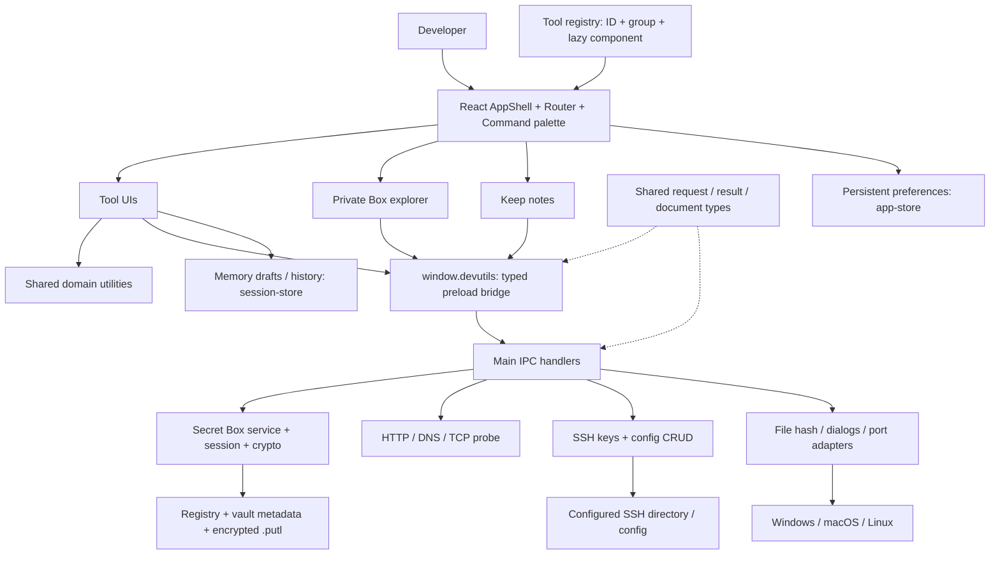
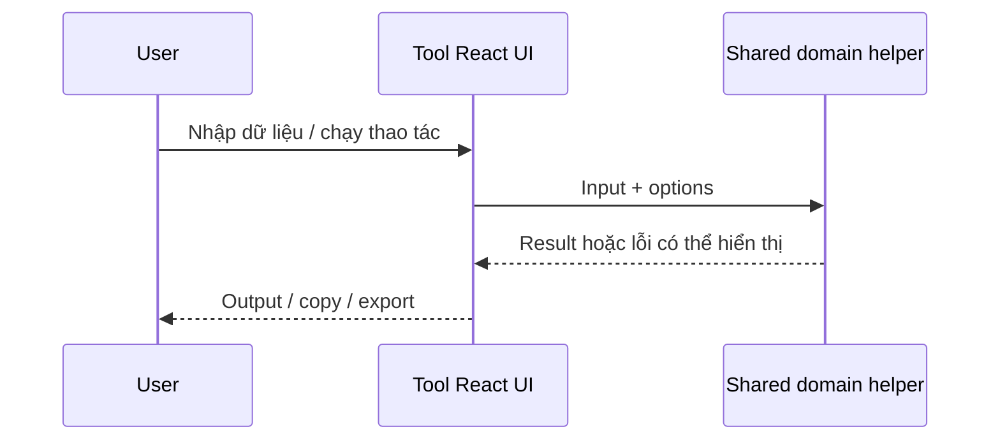
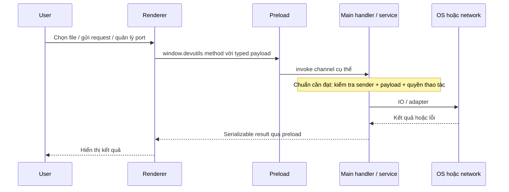
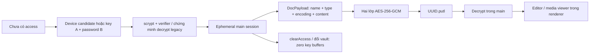

# DevUtils — bản đồ sản phẩm và code

Đối chiếu working tree ngày 2026-10-04, gồm cả code chưa commit. Đây là bản đồ
hiện trạng; các yêu cầu an toàn ở `../AGENTS.md` là chuẩn cần đạt. Lỗi đã biết nằm
trong [bản review](review-2026-10-04.md).

## Ý tưởng sản phẩm

Một bàn làm việc cho developer: xử lý JSON/YAML/SQL/HTML/XML, chuyển đổi dữ liệu,
crypto, công cụ network và file; lưu tài liệu nhạy cảm vào kho mã hóa; dùng Keep
để ghi chú. UI có sidebar, command palette, theme và ngôn ngữ thiết kế giống macOS.
Phần lớn xử lý tại máy. HTTP, DNS và kiểm tra TCP có truy cập mạng khi người dùng
chủ động chạy. SSH hiện quản lý key/config và kiểm tra TCP, chưa có terminal SSH
hay xác thực SSH thực sự.

Đích hiện tại là **desktop Windows/macOS/Linux**. Electron không tự làm cho app
này chạy trên iOS/Android; muốn thêm mobile cần một host và adapter khác.

## Map tổng thể

Quy tắc dependency: renderer và preload dùng shared; main dùng shared. Renderer
gọi main qua bridge, không import main. Shared không phụ thuộc Electron hoặc UI.
Trong shared có cả hàm thuần và helper cần Web Crypto/DOM/canvas; chọn đúng runtime
cho từng module, không mặc định tất cả đều chạy được trong Node.

## Điểm vào theo nhiệm vụ

| Nhiệm vụ | Đọc/sửa tại | Liên quan |
|---|---|---|
| Startup, cửa sổ, lifecycle | `src/main/index.ts` | preload, IPC registrars |
| API giữa UI và OS | `src/preload/index.ts` | `index.d.ts`, shared types, main handlers |
| Route, shell, phím tắt, theme | `src/renderer/src/App.tsx`, `layouts/AppShell.tsx` | `main.tsx`, `components/chrome` |
| Thêm/sửa tool và tìm kiếm | `src/renderer/src/registry/tools.ts` | `pages/ToolPage.tsx`, `features/tools/<group>` |
| Logic xử lý dữ liệu | `src/shared/<domain>` | test cạnh module, UI gọi logic |
| Settings và recent tools | `src/renderer/src/store/app-store.ts` | Zustand persist/localStorage |
| Draft/history tạm | `src/renderer/src/store/session-store.ts` | `hooks/useToolDraft.ts` |
| Vault setup/unlock/chuyển kho | `src/main/secret-box/vault.ts` | `session.ts`, `auth-rate.ts`, `device-secret.ts` |
| Vault đọc/ghi/đổi tên/xóa | `src/main/secret-box/fs-ops.ts` | `vault-paths.ts`, `atomic-write.ts`, `crypto.ts` |
| Import/export/Save to Box | `src/main/secret-box/export-import.ts` | `features/secret-box/SaveToBoxButton.tsx` |
| Content kind và editor | `src/shared/secret-box/content-kinds.ts` | `src/renderer/src/content/editors/registry.tsx` |
| Ghi chú Keep | `src/renderer/src/features/keep/KeepApp.tsx` | `src/shared/secret-box/keep-note.ts`, default vault |
| Key generation/SSH | `src/main/crypto-keys.ts`, `src/main/ssh` | shared crypto/SSH types, KeygenTool/SshManager |
| Port Manager | `src/main/platform/ports` | shared classify/types, `ports-ipc.ts`, UI |
| HTTP client | `src/main/http-request.ts` | `src/shared/http`, `features/tools/network/HttpClient.tsx` |
| UI tokens/components | `styles/globals.css`, `components/ui`, `tailwind.config.js` | các đường dẫn đầu tiên thuộc `src/renderer/src` |
| Bundle/installer | `electron.vite.config.ts`, `electron-builder.yml` | `scripts/after-pack.mjs`, `resources` |

`src/shared/privatebox/*` re-export compatibility từ `secret-box/*`. Tên UI
Private Box, service Secret Box và IPC `privateBox:*` cùng chỉ một domain. Không
tạo thêm một engine vault vì thấy tên khác nhau.

## Ba luồng mẫu để AI code đúng

### Tool xử lý tại máy

Thêm domain helper, test hành vi, UI và lazy entry trong registry. Tool ID đang
được dùng trong route/recent/history nên đổi ID cần xử lý tương thích. UI tái dùng
CodeEditor, toolbar, split pane và các token hiện có.

### Tác vụ cần quyền OS

Contract cần đặt trong shared, API nhỏ ở preload, logic tại main. Validation
runtime thuộc main; validate ở form giúp UX nhưng không thay thế trust boundary.

### Tài liệu trong vault

Key buffers được giữ tại main; **nội dung đã giải mã vẫn đi đến renderer** để
hiển thị/chỉnh sửa. Mã hóa bảo vệ dữ liệu lưu trên disk, không cách ly plaintext
khỏi UI của app khi kho đã mở.

## Bản đồ dữ liệu lưu

| Dữ liệu | Nơi lưu | Đặc tính |
|---|---|---|
| Preferences, recent ID, SSH paths | localStorage `devutils-app` | Persist; không lưu payload tool |
| Draft/history tool | Zustand session-store | Chỉ RAM; security, vault/Keep, SSH, HTTP và URL không lưu payload trong draft/history |
| Danh sách/active vault | `app.getPath('userData')/privatebox-registry.json` | JSON plaintext chứa tên/path |
| Default vault | `userData/data/default-secret-box` | Dùng chung Keep và Save to Box |
| Vault metadata | `<vault>/.privatebox/vault.json` | Salt, mode, KDF, verifier; cần backup |
| Tài liệu | `<vault>/<folder>/<UUID>.putl` | Payload mã hóa; folder name vẫn nhìn thấy |
| Device material cache | `userData/privatebox-device.secret` | safeStorage khi khả dụng; có legacy compatibility |
| SSH key/config | `~/.ssh` hoặc vị trí user chọn | File OS; không thuộc vault mã hóa |

Media/binary lưu dạng base64 bên trong payload mã hóa, editor hiện read-only.
Markdown editor đang dùng dữ liệu block dạng JSON, không phải mọi `.md` đều là
Markdown thuần. Khi sửa import/export hãy kiểm tra semantics này.

## Đường mở rộng hợp lý

Giữ Electron cho desktop và cải thiện adapter, hợp đồng IPC, privacy policy và
test trước. Không cần chuyển framework để thêm một tool. Nếu thật sự thêm web
hoặc mobile, tách host API/capability rõ ràng và chỉ tái dùng phần shared phù hợp
runtime; đánh dấu tool không có quyền OS thay vì giả lập thành công.

Chuẩn AI gồm Markdown + Mermaid trong Git. Không cần package runtime. Hướng dẫn
thao tác và các nguồn chính thức nằm trong [AI workflow](ai-workflow.md).
