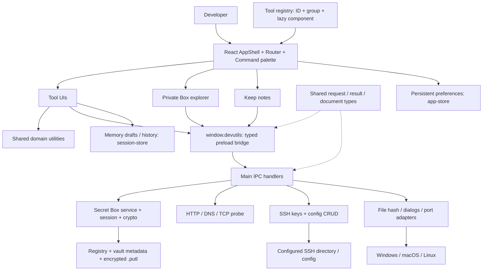
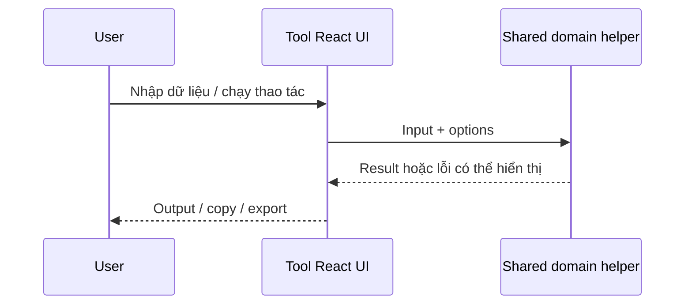
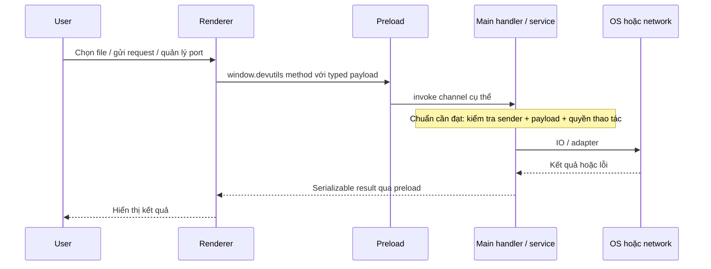
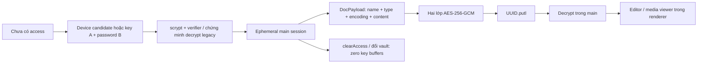

# DevUtils — bản đồ sản phẩm và code

Đối chiếu working tree ngày 2026-10-04, gồm cả code chưa commit. Đây là bản đồ
hiện trạng; các yêu cầu an toàn ở `../AGENTS.md` là chuẩn cần đạt. Lỗi đã biết nằm
trong [bản review](review-2026-10-04.md).

## Ý tưởng sản phẩm

Một bàn làm việc cho developer: xử lý JSON/YAML/SQL/HTML/XML, chuyển đổi dữ liệu,
crypto, công cụ network và file; lưu tài liệu nhạy cảm vào kho mã hóa; dùng Keep
để ghi chú. UI có sidebar, command palette, theme và ngôn ngữ thiết kế giống macOS.
Phần lớn xử lý tại máy. HTTP, DNS và kiểm tra TCP có truy cập mạng khi người dùng
chủ động chạy. SSH hiện quản lý key/config và kiểm tra TCP, chưa có terminal SSH
hay xác thực SSH thực sự.

Đích hiện tại là **desktop Windows/macOS/Linux**. Electron không tự làm cho app
này chạy trên iOS/Android; muốn thêm mobile cần một host và adapter khác.

## Map tổng thể

Quy tắc dependency: renderer và preload dùng shared; main dùng shared. Renderer
gọi main qua bridge, không import main. Shared không phụ thuộc Electron hoặc UI.
Trong shared có cả hàm thuần và helper cần Web Crypto/DOM/canvas; chọn đúng runtime
cho từng module, không mặc định tất cả đều chạy được trong Node.

## Điểm vào theo nhiệm vụ

| Nhiệm vụ | Đọc/sửa tại | Liên quan |
|---|---|---|
| Startup, cửa sổ, lifecycle | `src/main/index.ts` | preload, IPC registrars |
| API giữa UI và OS | `src/preload/index.ts` | `index.d.ts`, shared types, main handlers |
| Route, shell, phím tắt, theme | `src/renderer/src/App.tsx`, `layouts/AppShell.tsx` | `main.tsx`, `components/chrome` |
| Thêm/sửa tool và tìm kiếm | `src/renderer/src/registry/tools.ts` | `pages/ToolPage.tsx`, `features/tools/<group>` |
| Logic xử lý dữ liệu | `src/shared/<domain>` | test cạnh module, UI gọi logic |
| Settings và recent tools | `src/renderer/src/store/app-store.ts` | Zustand persist/localStorage |
| Draft/history tạm | `src/renderer/src/store/session-store.ts` | `hooks/useToolDraft.ts` |
| Vault setup/unlock/chuyển kho | `src/main/secret-box/vault.ts` | `session.ts`, `auth-rate.ts`, `device-secret.ts` |
| Vault đọc/ghi/đổi tên/xóa | `src/main/secret-box/fs-ops.ts` | `vault-paths.ts`, `atomic-write.ts`, `crypto.ts` |
| Import/export/Save to Box | `src/main/secret-box/export-import.ts` | `features/secret-box/SaveToBoxButton.tsx` |
| Content kind và editor | `src/shared/secret-box/content-kinds.ts` | `src/renderer/src/content/editors/registry.tsx` |
| Ghi chú Keep | `src/renderer/src/features/keep/KeepApp.tsx` | `src/shared/secret-box/keep-note.ts`, default vault |
| Key generation/SSH | `src/main/crypto-keys.ts`, `src/main/ssh` | shared crypto/SSH types, KeygenTool/SshManager |
| Port Manager | `src/main/platform/ports` | shared classify/types, `ports-ipc.ts`, UI |
| HTTP client | `src/main/http-request.ts` | `src/shared/http`, `features/tools/network/HttpClient.tsx` |
| UI tokens/components | `styles/globals.css`, `components/ui`, `tailwind.config.js` | các đường dẫn đầu tiên thuộc `src/renderer/src` |
| Bundle/installer | `electron.vite.config.ts`, `electron-builder.yml` | `scripts/after-pack.mjs`, `resources` |

Port Manager uses trusted named IPC and re-scans port/PID ownership before a
stop, refusing app/protected PIDs and known critical process names. Unix scans
use lsof field output; Linux also uses ss to retain sockets with hidden process
ownership. PID 0 represents unavailable ownership and must never enable Stop.
The scan is permission-limited; empty output is not proof no sockets exist.
See the [lsof field output specification](https://lsof.readthedocs.io/en/latest/manpage/)
and [ss options](https://man7.org/linux/man-pages/man8/ss.8.html).

File Hash dùng `src/main/file-hash.ts` để đọc từng khối 64 KB. Registrar
`file-hash-ipc.ts` giữ một job trên mỗi cửa sổ, gửi tiến độ theo request ID và
hủy bằng AbortSignal khi user hủy hoặc cửa sổ đóng. Preload chỉ cung cấp named
methods `hash`, `cancelHash`, `onHashProgress`; unsubscribe gỡ đúng listener.
File/hash/dialog và crypto key generation kiểm tra main frame + URL renderer qua
`ipc-trust.ts`; DNS cũng dùng guard này và giới hạn một query trên mỗi cửa sổ.
Các registrar khác còn nằm trong checklist review.

DNS Lookup nhận A/AAAA/MX/TXT/CNAME/NS/SRV/SOA/PTR. A/AAAA trả address + TTL;
PTR dùng complete IP và `Resolver.reverse`. Shared normalization giữ nguyên nhãn
DNS dạng số, xử lý IDNA và giới hạn tên; main dùng deadline 5 giây độc lập với
resolver cancellation. Truy vấn dùng DNS server đã cấu hình, không dùng hosts file
(xem [Node DNS API](https://nodejs.org/api/dns.html)).
DNS JSON responses can be saved through the common SaveToBoxButton. That control
requires the desktop bridge, shows write failures inline when no password dialog
is open, announces success/errors, and clears the password on cancellation.
Cancellation is disabled during an active save to avoid suggesting that an
already-running write was cancelled. Native failure/retry interaction still
needs verification.

HTTP dùng `http-ipc.ts` để giữ một request trên mỗi cửa sổ và hủy theo request ID.
Service validate payload tại runtime, đọc response từng khối với giới hạn 5 MB,
giữ binary/non-UTF-8 bằng `bodyEncoding: 'base64'`. Redirect trả về để user kiểm tra
Location và chạy request mới, không tự chuyển payload sang URL khác. Timeout bao
gồm thời gian đọc body. Request có duplicate params/form fields được giữ nguyên;
form mode là multipart text fields, chưa hỗ trợ upload file. HTTP response mặc định
hiện raw; format JSON dùng `format-text.ts` để giữ nguyên số, key trùng và escapes.
Code export ghi rõ shell/runtime, timeout và redirect policy; private request data
không lưu vào generic history/drafts. PowerShell body mã hóa base64 để giữ byte và
tránh phụ thuộc quoting/here-string (tham khảo [quy tắc PowerShell](https://learn.microsoft.com/en-us/powershell/module/microsoft.powershell.core/about/about_quoting_rules)).

Key Generator dùng Node crypto bất đồng bộ. `fingerprintSha256`/`fingerprintHex`
là SHA-256 của SPKI DER; `fingerprintOpenSshSha256` là SHA-256 của payload OpenSSH,
null cho X25519. Không đổi nghĩa hai field SPKI cũ. SSH key mới dùng fingerprint
OpenSSH trong kết quả tạo key. Renderer giữ key trong state của tool và có reveal,
copy, clear; generic history/drafts không lưu private key.

`src/shared/privatebox/*` re-export compatibility từ `secret-box/*`. Tên UI
Private Box, service Secret Box và IPC `privateBox:*` cùng chỉ một domain. Không
tạo thêm một engine vault vì thấy tên khác nhau.

## Ba luồng mẫu để AI code đúng

### Tool xử lý tại máy

Thêm domain helper, test hành vi, UI và lazy entry trong registry. Tool ID đang
được dùng trong route/recent/history nên đổi ID cần xử lý tương thích. UI tái dùng
CodeEditor, toolbar, split pane và các token hiện có.

### Tác vụ cần quyền OS

Contract cần đặt trong shared, API nhỏ ở preload, logic tại main. Validation
runtime thuộc main; validate ở form giúp UX nhưng không thay thế trust boundary.

### Tài liệu trong vault

Key buffers được giữ tại main; **nội dung đã giải mã vẫn đi đến renderer** để
hiển thị/chỉnh sửa. Mã hóa bảo vệ dữ liệu lưu trên disk, không cách ly plaintext
khỏi UI của app khi kho đã mở.

## Bản đồ dữ liệu lưu

| Dữ liệu | Nơi lưu | Đặc tính |
|---|---|---|
| Preferences, recent ID, SSH paths | localStorage `devutils-app` | Persist; không lưu payload tool |
| Draft/history tool | Zustand session-store | Chỉ RAM; security, vault/Keep, SSH, HTTP, URL và QR không lưu payload trong draft/history |
| Danh sách/active vault | `app.getPath('userData')/privatebox-registry.json` | JSON plaintext chứa tên/path |
| Default vault | `userData/data/default-secret-box` | Dùng chung Keep và Save to Box |
| Vault metadata | `<vault>/.privatebox/vault.json` | Salt, mode, KDF, verifier; cần backup |
| Tài liệu | `<vault>/<folder>/<UUID>.putl` | Payload mã hóa; folder name vẫn nhìn thấy |
| Legacy device recovery material | `userData/privatebox-device.secret` | Giữ nguyên để mở vault cũ; setup/unlock không ghi đè |
| Hardware hint cache | `userData/privatebox-hardware-cache.secret` | File riêng, chỉ safeStorage; tạo exclusive, không thay identity đã cache |
| SSH key/config | `~/.ssh` hoặc vị trí user chọn | File OS; không thuộc vault mã hóa; recovery key copies trong `.devutils-key-backup-<UUID>` |

SSH host edits use `patchSshHostConfig` to change a single unambiguous, literal
Host block in place. Raw lines and Host/Match order stay intact; Include files and
inherited values are not resolved by the inventory. Complex patterns and duplicate
aliases are read-only in the form. New specific hosts precede conditional blocks,
and include an explicit port. This follows OpenSSH's first-value and section rules
([official ssh_config reference](https://man.openbsd.org/ssh_config)). Config
mutations are queued per path and preserve UTF-8 bytes/line endings with a backup;
external changes are checked before writing, but this is not a filesystem lock
against another editor. Temporary config writes use mode 0600 on Unix.

SSH key creation now serializes RSA/Ed25519 into the unencrypted OpenSSH v1
private-key container ([OpenSSH specification](https://github.com/openssh/openssh-portable/blob/master/PROTOCOL.key)).
Generic Key Generator still returns PKCS#8; existing SSH key files are not migrated.
Private key writes first stage bytes in a new private directory: mode 0700/0600
on Unix, or an owner-only inheritable ACL applied through Windows PowerShell/.NET
before writing on Windows. Exclusive hard-link publication keeps the ACL and
prevents overwriting a concurrently created destination; replacements use a staged
rename after preserving original bytes. No permissions of an existing keys
directory are changed. Windows key writes require Windows PowerShell and a
filesystem supporting the ACL/link operations; failure does not fall back to an
unprotected write.

Key mutations validate regular files and protect custom config, config backups,
known_hosts and authorized_keys. Inventory groups a recognized private/public
pair and uses public-file metadata for its fingerprint; it does not authenticate
an existing pair. Reads are capped at 1 MiB for private files and 64 KiB for public
files. External public reads require an IdentityFile reference in the selected
config; repeated IdentityFile entries are retained. Relative paths and unresolved
host tokens are not guessed as home paths.

Delete/replacement retains plaintext recovery copies in the configured SSH
directory, with private-file permissions. Recovery metadata crosses the named
preload bridge and provides Open folder / Restore as actions; restore uses an
exclusive rename workflow and does not overwrite an occupied name. Partial
deletion returns recovery metadata plus an error. Backups survive closing the
tool, while the recovery action state is in memory only; later recovery is manual
through the backup folder. Rename does not modify IdentityFile references. These
per-root queues and pre-write checks are not locks against external processes.

Media/binary lưu dạng base64 bên trong payload mã hóa, editor hiện read-only.
Markdown editor đang dùng dữ liệu block dạng JSON, không phải mọi `.md` đều là
Markdown thuần. Khi sửa import/export hãy kiểm tra semantics này.

Private Box metadata reads distinguish absent files from corrupt JSON/UTF-8,
unreadable files and unsupported version/KDF/verifiers. Reads are bounded to
256 KiB and reject linked metadata directories/files. New default metadata may
only be initialized in an empty folder; existing documents or metadata remnants
prevent generating a replacement salt. A corrupt/invalid registry is preserved
instead of rebuilding it or dropping invalid entries. Status lists per-box errors
and a validated `vault.json.bak` path when available; it does not automatically
restore or assert that a backup's salt matches documents. Default initialization
errors leave other registered portable boxes available.

Explicit recovery uses the trusted `privateBox:recoverMetadata` bridge and the
selected registry box, only for missing/corrupt current metadata. Unsupported or
unreadable metadata is refused. Original keys must verify the fixed validated
`vault.json.bak`; every encrypted document, including hidden folders and metadata
remnants, must decrypt before publication. A legacy backup without verifiers
cannot prove an empty vault. Recovery refuses symlinks, changed snapshots and
limits exceeded (1,000 documents, 256 MiB total, 96 MiB per document); it never
silently skips documents. Exact backup bytes are restored without changing salt
or verifiers. Corrupt original bytes are preserved in an exclusive
`vault.json.before-recovery-<UUID>` file; the backup and document bytes are retained.
Recovery derives/verifies keys with asynchronous scrypt, checks the session
revision across IO and before commit, and transfers accepted keys to the session.
The login UI requires an explicit recovery choice and exposes Cancel through
clearAccess; it checks cancellation after the current async operation completes.
Normal setup/unlock still use synchronous KDF. Native recovery interaction,
progress feedback and external filesystem/process races remain unverified.

Legacy device material remains separate from the hardware cache. Candidate
unlock tries legacy material, live hardware identity and the OS-encrypted cache;
the cache is not a portable recovery key and can be unavailable after OS/account
changes. All Private Box IPC channels now guard the app frame and validate basic
payload shapes. Document paths reject root mutation and `.privatebox` access,
including realpath/junction aliases outside the vault or into metadata. These
checks are point-in-time; external replacement races remain open work. Do not
treat them as an OS-level filesystem lock.

Main file jobs now capture the access object and check its identity after awaited
IO and before staged file publication. Paths stay pinned to their original root;
read/list jobs discard old-session results, and import/export re-check after a
native dialog or disk read. Session revisions invalidate pending setup/unlock on
sign out or box selection. Atomic writes accept a synchronous beforeCommit guard
and remove a cancelled temp file; fallback replacement checks the guard again and
restores original bytes on failure. An OS mutation already issued cannot be
cancelled by JavaScript; a completion after session change is reported without
returning old plaintext. These guards do not stop external filesystem replacement.

SaveDocumentInput optionally carries boxId. Save to Box and Keep pin this ID from
their prepared default box, and main refuses a later save in a different active
box. Renderer access-error detection recognizes Electron's wrapped messages;
Private Box lists/opens discard superseded requests and remount the desktop when
the active box identity changes. A user edit arriving during Save stays dirty.
Registry reads (including legacy-pointer migration) and complete registry mutation
transactions now share a per-path main-process queue. Setup, add/select/remove/
rename and Default Box discovery read the latest registry while holding that queue;
one failed transaction releases it. Queued setup/add requests retain their session
revision, and a newer selection invalidates an older queued selection. Existing
Default Box discovery only writes the registry when its entry/active ID needs an
update, avoiding writes on each status refresh. This is an in-process queue;
external edits or two app processes still need coordination. Context tokens for
every separate CRUD IPC call, native multi-window behavior and authentication key
disposal still need review.

Keep passes passwords unchanged, retains failed-save drafts in memory, prevents
duplicate writes and reports unreadable note files. Unrecognized JSON note bodies
are shown as their original text rather than an empty note. Renderer save/error
flows still require native integration verification; no decrypted draft is added
to persistent settings or generic tool history.
Keep edits pass the original document body to serializeKeepNote. The serializer
patches only its six owned root fields and adds missing owned fields; unknown
members retain exact JSON bytes, including number lexemes, duplicate keys and
nested content. Unsupported color or timestamp field types are treated as raw
text rather than silently normalized. New notes use the existing JSON format.

## Đường mở rộng hợp lý

Shared text import uses fatal UTF-8 decoding. Line Endings opts into BOM
preservation; other tools retain their existing BOM stripping behavior. Input
changes/unmount invalidate pending file replacement, and Download is disabled
during file reading. Direct browser chooser verification is still pending after
an interrupted automation; domain byte-preservation tests do not prove native UI.

Settings distinguishes persisted preferences/recent tool IDs from payload drafts
and history held in the session store. Clear input drafts and Clear session history
are independent operations, preserving saved vault files. About obtains the actual
desktop version/platform or shows a preview/loading/error state; its privacy copy
must stay aligned with the NO_HISTORY_TOOLS policy and explicit HTTP/DNS/TCP scope.
Do not promise device-mode recovery after hardware, OS or account changes.

Image Convert decodes local File inputs with ImageBitmap and re-encodes through
canvas. Output is tied to the source/settings identity; changing either disables
preview/download until Convert runs again. File bytes and source/output dimensions
are bounded, and the actual Blob MIME must match the requested encoder before
using its extension. JPEG flattens alpha onto the selected background. Metadata
and animation are not preserved; source pixel validation happens after decoding.

JWT Decode inspects strict compact-JWS segments as JSON objects without checking
signatures. Verify uses current-input Web Crypto results and exact secret bytes;
it rejects unsupported critical headers and expected/header algorithm mismatches.
Only signature integrity is checked: issuer, audience and authorization policy
are not inferred. Invalid NumericDate claims produce warnings without hiding
otherwise decodable content. See [JWT claims](https://www.rfc-editor.org/rfc/rfc7519)
and [JWS critical headers](https://www.rfc-editor.org/rfc/rfc7515.html#section-4.1.11).

Regex execution runs only in a renderer module worker (`regex.worker.ts`),
terminated on timeout, cancellation, input changes or unmount. Shared operations
are synchronous and must not execute untrusted patterns on the renderer thread.
Replacement expansion is bounded before joining output; Test/Split cap display
results and report the limit. JavaScript Unicode/sticky/substitution semantics
follow [ECMAScript text processing](https://tc39.es/ecma262/2024/multipage/text-processing.html).

Cron previews support a documented 5/6-field subset with local or UTC time,
an explicit start instant and an eight-year horizon. parseCronStart validates
calendar fields before constructing Date, refusing normalized impossible days,
24:00, leap seconds, missing offsets and precision beyond milliseconds. The UI
shows a specific error beside After and disables schedule export on invalid input.
Search skips nonmatching
days and checks actual elapsed minutes to preserve DST folds. Seconds are
enumerated inside eligible minutes. Scheduler-specific extensions and DST
policy remain explicit; see [crontab semantics](https://man7.org/linux/man-pages/man5/crontab.5.html).

Giữ Electron cho desktop và cải thiện adapter, hợp đồng IPC, privacy policy và
test trước. Không cần chuyển framework để thêm một tool. Nếu thật sự thêm web
hoặc mobile, tách host API/capability rõ ràng và chỉ tái dùng phần shared phù hợp
runtime; đánh dấu tool không có quyền OS thay vì giả lập thành công.

Chuẩn AI gồm Markdown + Mermaid trong Git. Không cần package runtime. Hướng dẫn
thao tác và các nguồn chính thức nằm trong [AI workflow](ai-workflow.md).
